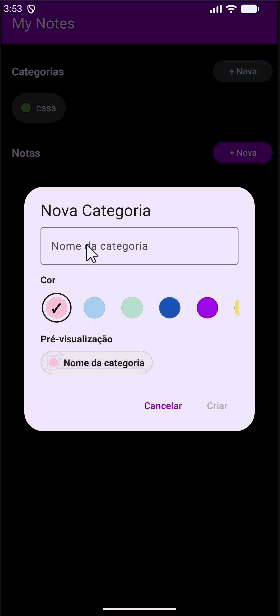
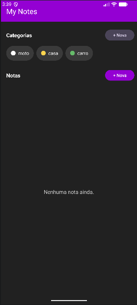
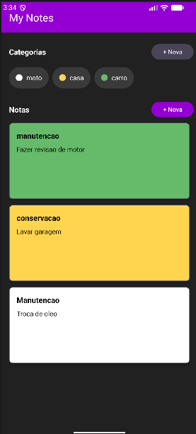
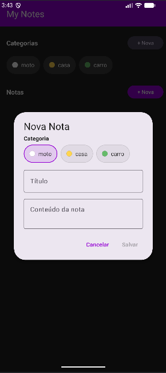
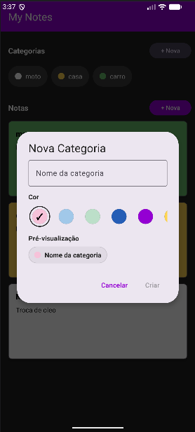
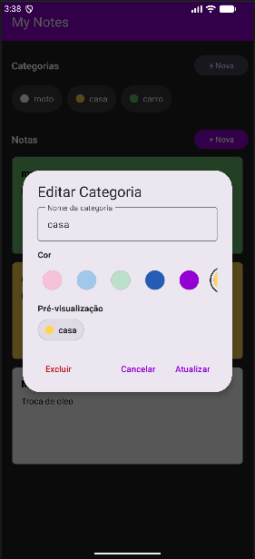

# My Notes — Aplicativo Android (Kotlin)

Documentação do aplicativo **My Notes** desenvolvido para a
**Avaliação Final — Programação para Dispositivos Móveis** (Prof. Jonas Bodê).

---

## 1. Proposta do Aplicativo

### Descrição Detalhada

O **My Notes** é um aplicativo Android nativo de gerenciamento de notas
tipo *post-it*, organizadas por categorias coloridas. O usuário pode
criar, editar e excluir notas e categorias, tudo sincronizado no
**Firebase Realtime Database** — com cache local em disco para
continuar funcionando quando estiver sem internet.

- **Objetivo:** Permitir que o usuário registre anotações rápidas de
  forma visual e organizada, usando cores para diferenciar assuntos.
- **Público-alvo:** Estudantes, profissionais e qualquer pessoa que
  precise de um bloco de notas simples e colorido no celular.
- **Problema resolvido:** Organizar pensamentos, tarefas e lembretes
  do dia a dia em um único lugar, com classificação visual por categoria.
- **Continuidade:** o aplicativo é uma evolução do projeto **My Notes**
  desenvolvido na Avaliação I. A interface e as funcionalidades foram
  mantidas, e a persistência foi migrada de Room (banco local) para
  **Firebase Realtime Database** (nuvem), incluindo o CRUD completo.

### Funcionalidades Principais

| #  | Funcionalidade                | Descrição                                                                                               |
| -- | ----------------------------- | --------------------------------------------------------------------------------------------------------- |
| 1  | Listar notas                  | Exibe cartões coloridos com título e conteúdo das notas                                                |
| 2  | Listar categorias             | Exibe chips com ponto colorido e nome de cada categoria                                                   |
| 3  | Criar nota                    | Diálogo com campos título, conteúdo e seleção de categoria                                           |
| 4  | Editar nota                   | Tocar em uma nota abre o diálogo já preenchido                                                          |
| 5  | Excluir nota                  | Botão "Excluir" disponível ao editar uma nota existente                                                 |
| 6  | Criar categoria               | Diálogo com nome e seletor de cor (paleta predefinida)                                                   |
| 7  | Editar categoria              | Tocar em uma categoria abre o diálogo para edição                                                      |
| 8  | Excluir categoria             | Botão "Excluir" disponível ao editar uma categoria existente                                            |
| 9  | Persistência na nuvem        | Firebase Realtime Database armazena notas e categorias (com cache offline)                                |
| 10 | Cores dinâmicas              | Cartões de nota coloridos pela categoria; cor da categoria nos chips e na pré-visualização dos modais |
| 11 | Estado de erro                | Mensagens de erro exibidas em Snackbar com tratamento adequado                                            |
| 12 | Sincronização em tempo real | Alterações no Firebase aparecem automaticamente na tela via listeners reativos                          |

---

## 2. Design e Usabilidade

### Interface do Usuário

- **Tema escuro** com **cabeçalho roxo** (`#9400D3`).
- **Cartões de notas coloridos** conforme a cor da categoria,
  facilitando a identificação visual.
- **Chips de categorias** com bolinha colorida + nome.
- Navegação intuitiva: tudo em uma única tela com seções claras
  (*Categorias* e *Notas*) e botões de ação sempre visíveis.
- **XML + View System**
  (layouts editáveis no Android Studio — Layout Preview/Design Editor)
  com **Material Components**.

### Experiência do Usuário

- Indicador de carregamento (*ProgressBar*) durante a
  inicialização.
- Mensagem amigável quando não há notas cadastradas.
- Validação de formulários: botões de salvar só habilitam com
  formulário válido.
- Feedback visual de erros via Snackbar.

---

## 3. Implementação Técnica

### Arquitetura

```
📦 My Notes /
└── 📂app/src/main/
    ├── 📂java/com/example/my_notes/
    │   ├── 📂data/                       # Camada de dados
    │   │   ├── 📂model/                  # Modelos
    │   │   │   ├── 📄Note.kt             # Nota (id = chave do Firebase)
    │   │   │   └── 📄Category.kt         # Categoria (id = chave do Firebase)
    │   │   ├── 📂remote/                 # Integração com o Firebase
    │   │   │   ├── 📄FirebaseMapping.kt  # Snapshot <-> Note/Category
    │   │   │   └── 📄FirebaseFlow.kt     # ValueEventListener -> Flow
    │   │   └── 📂repository/
    │   │       └── 📄NotesRepository.kt  # CRUD no Realtime Database
    │   ├── 📂di/
    │   │   └── 📄AppModule.kt            # Hilt: FirebaseDatabase + dispatcher
    │   ├── 📂ui/
    │   │   ├── 📂adapter/
    │   │   │   ├── 📄NotesAdapter.kt     # RecyclerView de notas (DiffUtil)
    │   │   │   └── 📄CategoriesAdapter.kt# Chips de categorias (DiffUtil)
    │   │   ├── 📂feature/
    │   │   │   └── 📄NotesViewModel.kt   # ViewModel + UiState (StateFlow)
    │   │   └── 📂dialogs/
    │   │       ├── 📄NoteDialog.kt       # Diálogo criar/editar/excluir nota
    │   │       ├── 📄CategoryDialog.kt   # Diálogo criar/editar/excluir categoria
    │   │       └── 📄DialogUi.kt         # Paleta de cores + helpers visuais
    │   ├── 📂util/
    │   │   ├── 📄ColorUtils.kt           # parseHexColor + contraste de fonte
    │   │   └── 📄TaskExtensions.kt       # Task do Firebase -> suspend
    │   ├── 📄MyNotesApplication.kt       # @HiltAndroidApp
    │   └── 📄MainActivity.kt             # @AndroidEntryPoint + setContentView
    ├── 📂res/layout/                     # Layouts XML (editáveis no Design Editor)
    │   ├── 📄activity_main.xml           # Tela principal (Toolbar + listas)
    │   ├── 📄item_note.xml               # Card de nota
    │   ├── 📄item_category.xml           # Chip de categoria
    │   ├── 📄dialog_note.xml             # Formulário de nota
    │   ├── 📄dialog_category.xml         # Formulário de categoria
    │   └── 📄item_color_swatch.xml       # Swatch da paleta de cores
    └── 📄AndroidManifest.xml             # Permissão INTERNET + Activity
```

### Recursos do Android SDK Utilizados

| Recurso                              | Onde é usado                                                       |
| ------------------------------------ | ------------------------------------------------------------------- |
| **XML + View System**          | Toda a interface (layouts editáveis no Design Editor)              |
| **RecyclerView + DiffUtil**    | Listas de notas e categorias (adapters próprios)                   |
| **Material Components**        | Botões, caixas de texto, AlertDialogs, Toolbar, Snackbar           |
| **Firebase Realtime Database** | Persistência e sincronização em tempo real                       |
| **Hilt**                       | Injeção de dependência (FirebaseDatabase, Repository, ViewModel) |
| **ViewModel + StateFlow**      | Gerenciamento de estado sobrevivente a rotações                   |
| **Coroutines + Flow**          | Observação reativa do Firebase e escritas assíncronas            |
| **Snackbar / Toast**           | Tratamento/feedback de erros de interface                           |
| **repeatOnLifecycle**          | Coleção do StateFlow apenas em primeiro plano                     |

### Tratamento de Eventos

- Cliques em botões (*Nova nota*, *Nova categoria*, *Confirmar*,
  *Cancelar*, *Excluir*) mapeados para métodos do `NotesViewModel`.
- Tocar em nota/categoria abre o diálogo de edição correspondente.
- Fechamento de diálogos via botão ou toque fora — o
  `setOnDismissListener` sincroniza o estado no `NotesViewModel`.
- Erros do Firebase capturados com `try/catch` e exibidos em Snackbar.
- Erros de `Flow` tratados com o operador `catch`.

### Integração com o Firebase Realtime Database

A persistência foi migrada de um banco local (Room) para o
**Firebase Realtime Database**. O app não usa autenticação: as regras
do banco estão abertas para fins acadêmicos (veja a seção 5.1).

**Dependências e configuração:**

- `com.google.firebase:firebase-database:23.0.0`
- Plugin `com.google.gms.google-services` aplicado no módulo `app`
- `app/google-services.json` vinculado ao pacote `com.example.my_notes`
- Permissão `android.permission.INTERNET` no manifest
- URL do banco em `res/values/strings.xml` (`firebase_database_url`)

**Fluxo da integração:**

```
MainActivity (XML/Views)
        │  eventos (salvar, excluir, abrir diálogo)
        ▼
NotesViewModel (StateFlow)
        │  suspend / Flow
        ▼
NotesRepository
        │  setValue() / removeValue() / addValueEventListener()
        ▼
Firebase Realtime Database
        │  onDataChange()
        ▼
FirebaseFlow (callbackFlow) → Flow<List<Note>> / Flow<List<Category>>
        │
        ▼
NotesViewModel atualiza o UiState → MainActivity renderiza
```

**Operações CRUD:**

| Operação             | Método do repositório                                   | Chamada no Firebase                   |
| ---------------------- | --------------------------------------------------------- | ------------------------------------- |
| Listar notas           | `observeNotes()`                                        | `addValueEventListener` → `Flow` |
| Listar categorias      | `observeCategories()`                                   | `addValueEventListener` → `Flow` |
| Criar nota/categoria   | `saveNote()` / `saveCategory()` com `id` vazio      | `push()` + `setValue()`           |
| Editar nota/categoria  | `saveNote()` / `saveCategory()` com `id` preenchido | `child(id)` + `setValue()`        |
| Excluir nota/categoria | `deleteNote()` / `deleteCategory()`                   | `child(id)` + `removeValue()`     |

**Detalhes de implementação:**

- O **id de cada registro é a própria chave** gerada pelo Firebase
  (`push()`), por isso os modelos usam `id: String`.
- O payload gravado **não inclui o id**; ele já é o nome do nó.
- As escritas (`setValue` / `removeValue`) são convertidas em chamadas
  `suspend` via `suspendCancellableCoroutine` (`TaskExtensions.kt`).
- A leitura é reativa com `callbackFlow`; ao cancelar a coleta, o
  `ValueEventListener` é removido com `awaitClose`.
- Notas são ordenadas da mais nova para a mais antiga e categorias por
  ordem de criação (ordem das chaves `push`).
- **Cache offline:** `setPersistenceEnabled(true)` mantém uma cópia em
  disco, permitindo usar o app sem internet e sincronizar depois.
- Erros do Firebase (`permission denied`, rede, etc.) são propagados
  como exceções e exibidos em Snackbar/Toast pelo `NotesViewModel`.

### Persistência de Dados

Estrutura dos nós no Realtime Database:

```json
{
  "notes": {
    "-NxAbC123": {
      "title": "Estudar Kotlin",
      "content": "Revisar Coroutines",
      "categoryId": "-NxCat456"
    }
  },
  "categories": {
    "-NxCat456": {
      "name": "Estudos",
      "color": "#a1c8e9"
    }
  }
}
```

A URL do banco fica em
`app/src/main/res/values/strings.xml` (`firebase_database_url`).

### Padrões de Design Aplicados

- **MVVM** (Model–View–ViewModel): UI observa o `StateFlow` do ViewModel.
- **Repository**: centraliza acesso a dados e despacha para IO.
- **Dependency Injection** (Hilt): desacoplamento e testabilidade.
- **Unidirectional Data Flow**: eventos sobem, estado desce.

---

## 4. Critérios de Avaliação — Conferência

Critérios definidos na **Avaliação Final** (Prof. Jonas Bodê):

| # | Critério                                     | Peso | Como o projeto atende                                                                                                                                                                                                                      |
| - | --------------------------------------------- | ---- | ------------------------------------------------------------------------------------------------------------------------------------------------------------------------------------------------------------------------------------------ |
| 1 | **Funcionalidade Geral**                | 20%  | Navegação funcional entre a tela principal (seções *Categorias* e *Notas*) e os diálogos; criação, listagem, edição e exclusão de notas e categorias operacionais.                                                           |
| 2 | **Integração com Banco de Dados**     | 35%  | Firebase Realtime Database com as quatro operações CRUD integradas à interface; leitura reativa por `addValueEventListener`; persistência em disco (`setPersistenceEnabled(true)`) mantendo os dados após fechar e reabrir o app. |
| 3 | **Interface do Usuário e Usabilidade** | 20%  | XML/View System + Material Components; tema escuro, cartões coloridos por categoria; estados de loading e de lista vazia; feedback de erros por Snackbar/Toast e fechamento dos diálogos após salvar.                                   |
| 4 | **Qualidade do Código**                | 15%  | Arquitetura em camadas (UI → ViewModel → Repository → Firebase); MVVM, Repository, Hilt e Unidirectional Data Flow; 36 testes unitários (MockK + Turbine); tratamento de erros e validações.                                         |
| 5 | **Documentação do Projeto**           | 10%  | Este README cobre nome e descrição, objetivo e público-alvo, funcionalidades, tecnologia de banco, explicação do CRUD, instruções de execução e capturas de tela.                                                                 |

### Conferência dos Requisitos da avaliação

| Requisito exigido                                                                              | Onde está atendido / evidência                                             | Situação |
| ---------------------------------------------------------------------------------------------- | ---------------------------------------------------------------------------- | :--------: |
| Descrição detalhada (objetivo, público-alvo e problema)                                     | Seção 1 — Proposta do Aplicativo                                          |     ✅     |
| Funcionalidades principais listadas e descritas                                                | Seção 1 — Funcionalidades Principais                                      |     ✅     |
| Continuidade da Avaliação I ou novo desenvolvimento                                          | Seção 1 — item **Continuidade**                                     |     ✅     |
| Interface organizada e navegação funcional entre telas                                       | Seção 2 — Design e Usabilidade                                            |     ✅     |
| Feedback das operações e avisos de erro                                                      | Seção 2 — Experiência do Usuário; Seção 3 — Tratamento de Eventos    |     ✅     |
| Banco de dados obrigatório                                                                    | Seção 3 — Firebase Realtime Database                                      |     ✅     |
| CRUD completo (Create, Read, Update, Delete)                                                   | Seção 3 — tabela de operações CRUD                                      |     ✅     |
| Validação de dados e tratamento de eventos                                                   | Seção 2 — validação de formulários; Seção 3 — Tratamento de Eventos |     ✅     |
| Persistência após encerrar e reabrir o aplicativo                                            | Seção 3 — cache offline e persistência em disco                          |     ✅     |
| Documentação com nome/descrição, objetivo, funcionalidades, banco, CRUD e capturas de tela | Seções 1–3 e Seção 8 — Capturas de Tela                                |     ✅     |

---

## 5. Como Executar

```bash
# Compilar o APK de debug
./gradlew assembleDebug

# Executar os testes unitários
./gradlew testDebugUnitTest
```

O APK gerado fica em:
`app/build/outputs/apk/debug/app-debug.apk`

### 5.1 Configuração do Firebase (já aplicada)

O projeto já está conectado e com o banco provisionado:

| Item                      | Valor                                                               |
| ------------------------- | ------------------------------------------------------------------- |
| Projeto                   | `my-notes-mobile-firebase`                                        |
| Instância                | `my-notes-mobile-firebase-default-rtdb` (região `us-central1`) |
| URL do banco              | `https://my-notes-mobile-firebase-default-rtdb.firebaseio.com`    |
| Arquivo de configuração | `app/google-services.json`                                        |
| Regras atuais             | leitura/escrita públicas (uso acadêmico)                          |

A URL está declarada em `app/src/main/res/values/strings.xml`:

```xml
<string name="firebase_database_url" translatable="false">https://my-notes-mobile-firebase-default-rtdb.firebaseio.com</string>
```

Se o banco for recriado em outra região, copie a URL exibida no console
e atualize esse valor.

#### Regras de segurança

As regras atuais são:

```json
{
  "rules": {
    ".read": true,
    ".write": true
  }
}
```

O console do Firebase exibe o aviso **“Suas regras de segurança estão
definidas como públicas”**. Isso é esperado: com `.read` e `.write`
como `true`, qualquer pessoa que tenha a URL pode ler, alterar ou
excluir dados. A URL fica embutida no APK, então essa configuração é
adequada **apenas para o trabalho acadêmico com dados de teste** — não
use dados pessoais reais.

Para um app em produção, use autenticação. Com **Firebase
Authentication anônima**:

```json
{
  "rules": {
    ".read": "auth != null",
    ".write": "auth != null"
  }
}
```

Para separar os dados por usuário (mais seguro), a estrutura passaria a
ser `users/<uid>/notes` e `users/<uid>/categories` com regras
`auth.uid === $uid`.

#### Diagnóstico de erros

| Sintoma                                                  | Causa provável                   | Solução                          |
| -------------------------------------------------------- | --------------------------------- | ---------------------------------- |
| `404 Not Found` ao acessar `...firebaseio.com/.json` | Realtime Database não criado     | Criar o banco no console           |
| `401 Permission denied`                                | Regras bloqueando leitura/escrita | Publicar regras permitindo acesso  |
| `Failed to get FirebaseDatabase instance`              | URL ausente ou inválida          | Conferir `firebase_database_url` |
| Dados não aparecem no app                               | Sem internet e sem cache local    | Conectar-se e reabrir o app        |
| `Permission denied` ao salvar                          | Regras não publicadas            | Revisar a aba **Regras**     |

> O arquivo `app/google-services.json` já está configurado para o
> pacote `com.example.my_notes`.

---

## 6. Stack Tecnológica

| Tecnologia            | Versão   |
| --------------------- | --------- |
| Kotlin (built-in AGP) | AGP 9.3.3 |
| Material Components   | 1.14.0    |
| RecyclerView          | 1.4.0     |
| Firebase Database     | 23.0.0    |
| Hilt                  | 2.60.1    |
| KSP                   | 2.3.11    |
| Coroutines            | 1.10.2    |
| Lifecycle             | 2.9.4     |
| Gradle                | 9.5.0     |
| minSdk / targetSdk    | 24 / 37   |

---

## 7. Testes

Suíte de testes em `app/src/test/`:

- **NotesViewModelTest** (15 testes): carregamento inicial, abertura de
  diálogos, salvar/excluir notas e categorias, rejeição de nome duplicado,
  preservação de caracteres especiais, tratamento de erros,
  cor por categoria.
- **NotesRepositoryTest** (11 testes): leitura reativa ordenada, geração
  de chaves com `push()`, atualização por id, exclusão e propagação de
  erros do Firebase.
- **FirebaseMappingTest** (5 testes): conversão entre snapshots e os
  modelos, incluindo campos ausentes e payloads sem o id.
- **ParseHexColorTest** (4 testes): conversão de cores hexadecimais.
- **ExampleUnitTest** (1 teste): sanity check do template.
- **MainDispatcherRule**: regra JUnit para Dispatcher.Main em testes.

Os testes da camada de dados usam **MockK** para simular o
`FirebaseDatabase`, os snapshots e as `Task`, então rodam offline, sem
precisar de conexão com o Firebase.

Há também o teste de UI **DialogSpecialCharactersTest**
(`app/src/androidTest/`, Espresso + activity hospedeira) que valida a
digitação de caracteres especiais nos modais — rodar com
dispositivo/emulador: `./gradlew connectedDebugAndroidTest`.

Todos os **36 testes unitários passam** com `./gradlew testDebugUnitTest`.

---

## 8. Capturas de Tela — Layout do Aplicativo

<p align="center"></p>

Imagens do layout real do **My Notes** (pasta [`img/`](img/)).

### Tela principal (estado inicial)

Lista de categorias em *chips* e seção de notas com o estado vazio
(*"Nenhuma nota ainda"*), cabeçalho roxo e botões **+ Nova** sempre visíveis.

<p align="center"></p>

### Lista de notas

Cartões coloridos conforme a cor da categoria — fundo branco com texto
preto (categoria branca) e demais cores com texto branco. Categorias
criadas pelo usuário aparecem na barra de *chips*.

<p align="center"></p>

### Modal de nova nota

Modal de fundo branco com chips de categoria (seleção destacada em
roxo), campos **Título** e **Conteúdo** e botões **Cancelar**/**Salvar**
em hierarquia Material 3.

<p align="center"></p>

### Modal de nova categoria

Nome, paleta de cores (incluindo branco) com anel de seleção,
**pré-visualização** do chip em tempo real e botão **Criar** roxo.

<p align="center"></p>

### Modal de editar categoria

Mesmo modal em modo de edição: nome preenchido, **Atualizar** (primário),
**Excluir** (outline vermelho) e **Cancelar**.

<p align="center"></p>

## 📄 Licença

Este projeto está licenciado sob a licença MIT - veja o arquivo [LICENSE](LICENSE) para detalhes.

### 💚 Feito com dedicação KOTLIN e café ☕

---

Desenvolvido como atividade avaliativa acadêmica prática de desenvolvimento Android.
